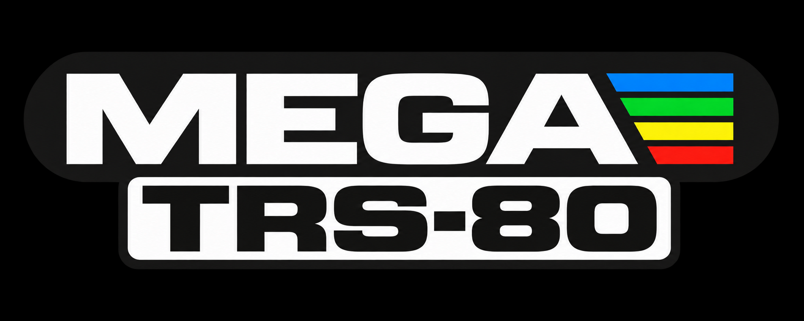

<p align="center"></p>

TRS-80 Model I for MEGA65 (megatrs80)
=====================================

This is a port of the [TRS-80_MiSTer](https://github.com/MiSTer-devel/TRS-80_MiSTer) core
(the HT1080Z MiST core by Jozsef Laszlo, ported to MiSTer and extended by Alan Steremberg,
Stephen Eddy, theflynn49 and others) to the [MEGA65](https://mega65.org), using the
[MiSTer2MEGA65](https://github.com/sy2002/MiSTer2MEGA65) framework (version 2.0.1).
Ported to the MEGA65 by Chris Freeman.

**Status: work in progress.** Tested on a MEGA65 R6: boot to BASIC, keyboard, cassette loading
and booting NEWDOS/80 from a JV1 disk image work. Not tested on hardware yet: CMD/BAS loading,
disk writes, CPU speeds, sound and the R3/R4/R5 builds.

Features
--------

* TRS-80 Model I with 48 KB RAM (Level II BASIC or System-80 ROM)
* Expansion interface with four floppy drives (JV1 disk images, read and write) and the
  real time clock (25 ms interrupt)
* Loading of programs (`.CMD`, binary `.BAS`) and cassettes (`.CAS`) from the SD card
* CPU speed 1.78 MHz, 3.56 MHz, 5.34 MHz or 21.29 MHz (cassettes are always read at full speed)
* White, green or amber screen, lower case as symbols, video flicker, no / partial / full
  overscan, the TRS-80 "skin" in the overscan area, debug status line
* Omikron CP/M mapper (needs the Omikron mapper ROM, see below)
* BIG5 and Alpha Products Trisstick joysticks in joystick port 1
* Sound (cassette port and the HT1080Z's AY-3-8910)
* HDMI (720p/576p/480p/600p) and VGA output: 31 kHz or 15 kHz RGB (optionally with
  composite sync), CRT emulation and zoom-in for HDMI
* Runs on all MEGA65 models: R3/R3A, R4, R5 and R6 (the TRS-80 RAM is block RAM, the disk
  images are buffered in the HyperRAM)

Not supported (yet): save states (the MiSTer core stores them in the DDR3 RAM), the RS232
interface and MIDI/80 (they would need the PMOD headers of the MEGA65) and the MT32-pi.

SD card
-------

Create a folder `/trs80` on the SD card:

* `boot.rom` (mandatory): a TRS-80 Model I ROM (Level II BASIC, 12 KB, or a System-80 ROM,
  14 KB). The MiSTer core's documentation explains how to patch the ROM for fast cassette
  loading.
* `boot1.rom` (optional): the Omikron CP/M mapper ROM
* your disk images (`.DSK`, `.JV1`), programs (`.CMD`, `.BAS`) and cassettes (`.CAS`)
* optionally `trs80cfg`, an empty settings file, if you want the menu settings to be saved:
  `cd M2M/tools && ./make_config.sh trs80cfg auto`. The file must have exactly as many bytes
  as the menu has lines (`OPTM_SIZE` in `CORE/vhdl/config.vhd`, currently 77). When the menu
  changes, a settings file of the old size is ignored: create a new one.

Usage
-----

* Press <kbd>Help</kbd> to open the on-screen menu: mount disk images, load programs and
  cassettes, change the CPU speed, the screen and the video output.
* Disks: mount a JV1 disk image as "Disk 0" and reset the TRS-80 ("Reset TRS-80" in the menu or
  the reset button of the MEGA65) to boot from the disk. Only JV1 images are supported (like the
  MiSTer core): 10 sectors of 256 bytes per track, single sided. Disks cannot be formatted.
* Programs: "Program" loads a `.CMD` or a binary `.BAS` file (the first byte of the file decides
  which of the two it is). "System settings" / "Start CMD" defines how a CMD program is started:
  with the stack at 4200h (for programs from cassettes, default), with a plain JMP, or not at all
  (load only; safest under DOS). BAS files are loaded at the `>` prompt of BASIC; then type
  `LIST` or `RUN`.
* Cassettes: at the BASIC prompt type `SYSTEM` (Return), then load the `.CAS` file with
  "Cassette", type the first letter of the program's name (Return), and `/` (Return) to start it.
* "Erase memory & reset" clears the RAM and restarts the TRS-80 (needed after switching the
  Omikron CP/M mapper on).
* Keyboard (the MEGA65 has a C64 style layout; the shifted digits and `, < . > / ?` are the same
  as on the TRS-80, so the keys are mapped by their labels):

  | MEGA65                   | TRS-80                     |
  |--------------------------|----------------------------|
  | `@ : ; , - . /`          | `@ : ; , - . /`            |
  | `*` `+` `=`              | Shift + `:` `;` `-`        |
  | Return                   | ENTER                      |
  | Clr/Home, Tab            | CLEAR                      |
  | Run/Stop, Esc            | BREAK                      |
  | Cursor keys              | arrow keys                 |
  | Inst/Del, `←`            | left arrow (backspace)     |
  | `↑`                      | up arrow                   |
  | Ctrl                     | Shift + down arrow         |

Building
--------

```
git clone --recursive https://github.com/freemchr/megatrs80.git
cd megatrs80/M2M/QNICE/tools && ./make-toolchain.sh     # answer all questions with Return
cd ../../../CORE/m2m-rom && ./make_rom.sh               # firmware (also run by Vivado)
```

Then open `CORE/CORE-R6.xpr` (or R3, R4, R5 for the other MEGA65 models) with Vivado and
generate the bitstream. Convert the bitstream into a `.cor` file with `bit2core` from
[mega65-tools](https://github.com/MEGA65/mega65-tools):
`bit2core mega65r6 CORE/CORE-R6.runs/impl_1/mega65_r6.bit TRS-80 0.1 trs80.cor`.

Design
------

The MiSTer core is a Git submodule (`CORE/TRS-80_MiSTer`) and is used unchanged, except for
a few files that need small changes for the Xilinx tools: `CORE/patches/*.patch` are applied to
copies in `CORE/vhdl/trs80_patched` by `CORE/patches/apply_patches.sh` (case statements without
`when others`, component instantiations without `entity`, procedural assignments to wires and
signals that are used in port connections before their declaration).

| File                                   | Purpose |
|----------------------------------------|---------|
| `CORE/vhdl/trs80/trs80_top.sv`         | TRS-80 part of the MiSTer top level `TRS-80.sv` (loader, Omikron ROM, audio) without hps_io, video mixer, MT32-pi and save states |
| `CORE/vhdl/trs80/ioctl_loader.vhd`     | QNICE devices for `boot.rom`, `boot1.rom`, programs and cassettes; emulates MiSTer's ioctl downloads (incl. `ioctl_wait`) in the core's clock domain |
| `CORE/vhdl/trs80/fdc_bridge.vhd`       | clock domain crossing between the M2M virtual drives and the TRS-80 floppy controller (based on the MegaST bridge) |
| `CORE/vhdl/m65_keyboard.vhd`           | MEGA65 keyboard to TRS-80 keyboard matrix |
| `CORE/vhdl/trs80/keyboard_matrix.vhd`  | replaces the MiSTer core's PS/2 keyboard (`keyboard.sv`): receives the matrix |
| `CORE/vhdl/trs80/sprom.vhd`            | Xilinx version of the skin ROM (`skin4.mem`, generated by `CORE/tools/mif2mem.py`) |
| `CORE/vhdl/main.vhd`, `mega65.vhd`     | M2M wrappers: menu, drives, HyperRAM disk buffers, video and audio settings |
| `CORE/vhdl/config.vhd`                 | menu, welcome and help screens; the menu is generated by `CORE/tools/gen_menu.py` |
| `CORE/vhdl/clk.vhd`                    | 42.578125 MHz core clock (MiSTer: 42.578 MHz) |
| `CORE/m2m-rom/m2m-rom.asm`             | firmware callbacks: file filter, "Reset TRS-80" and "Erase memory & reset" |

After updating the submodule: run `CORE/patches/apply_patches.sh`, `python3 CORE/tools/mif2mem.py`
and `python3 CORE/tools/update_xpr.py` (updates the file lists of the Vivado projects).

Tests
-----

Needs the [OSS CAD Suite](https://github.com/YosysHQ/oss-cad-suite-build) (GHDL, Verilator).

* `CORE/sim/check_design.sh R6`: GHDL analysis and elaboration of the whole design below the
  M2M framework (and of the TRS-80's VHDL)
* `CORE/sim/run_tb.sh tb_ioctl_loader`: the ROM, program and cassette loader against a model of
  the M2M firmware and of the MiSTer core's loader
* `CORE/sim/boot_sim.sh <boot.rom> <ms> [options]`: simulation of the whole core (GHDL
  synthesis to Verilog + Verilator). It writes the TV picture as `frame.ppm`, can type on the
  keyboard and load programs, e.g.
  `CORE/sim/boot_sim.sh CORE/TRS-80_MiSTer/releases/BOOT.ROM 7600 "+type=_||||||PRINT 2+3*4_"`

License
-------

GPL v3, see [LICENSE](LICENSE). The MiSTer core has its own licenses (see the submodule).
